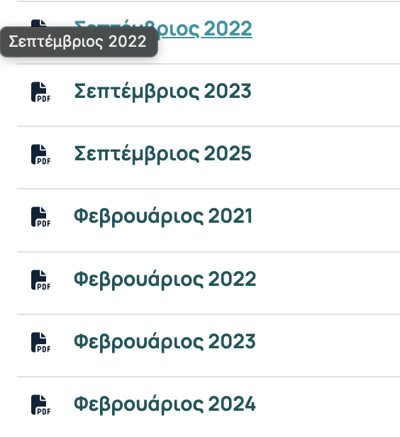
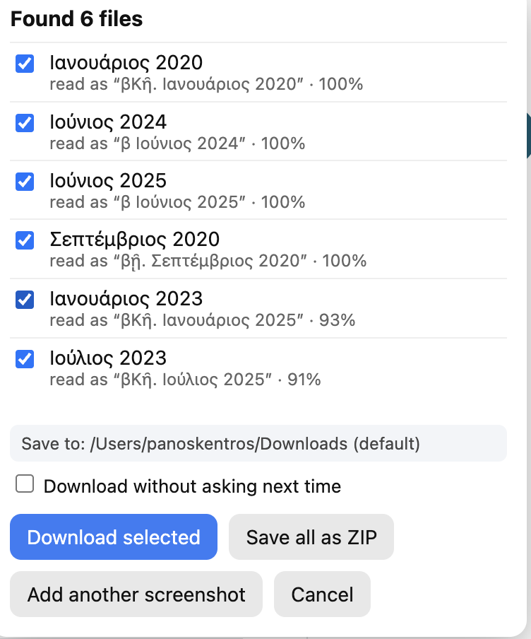

# File Grabber

A small Chrome extension I wrote because I was tired of clicking through a long list of course files one by one.

You drag a box around a list of file names on a page (or paste a screenshot of one), and File Grabber reads the names, finds the matching links on that page and downloads them for you.

I built it for my university's eClass, where the lecture files sit in a long table, but it should work on any page that lists files as links.



## How it works

1. Click the extension icon (or press `Alt+Shift+G`).
2. Drag over the list of file names. Or press `Cmd/Ctrl+V` to paste a screenshot you already took, or drop an image onto the page.
3. The extension reads the text in that area with OCR and compares it with the links on the page.
4. A small panel lists what it found. Untick anything you don't want, then download the files one by one, or all together as a single ZIP.



Under each file you can see what the OCR actually read and how close the match is. OCR isn't perfect (in the screenshot above it read "2023" as "2025" twice), which is why the panel is there: have a quick look before you hit download.

## Install

It isn't on the Chrome Web Store, so you load it yourself:

1. Download or clone this repo.
2. Open `chrome://extensions` and switch on **Developer mode**.
3. Click **Load unpacked** and choose the project folder.

## Good to know

- **Everything stays on your computer.** The OCR (Tesseract.js, with Greek and English data) is bundled and runs inside the browser. Nothing is uploaded anywhere.
- **Greek and English** names both work. Accents and the two kinds of sigma are ignored when matching.
- **Your login is used.** Files are downloaded with the session you already have in the browser, so it only reaches files you could open yourself.
- **If the OCR finds nothing**, it falls back to the file links inside the box you drew.
- **Several screenshots?** Use "Add another screenshot" to keep what you found and add more, then download everything at once. Every new run starts clean; nothing from earlier runs is kept.
- **Folders.** If a name turns out to be a folder (like an eClass document folder), the files inside it are listed instead, subfolders included, and saved into matching subfolders (or the same paths inside the ZIP). Only files whose names show an extension are picked up.
- **"Download without asking next time"** skips the panel and repeats whatever you did last (files or ZIP). It is saved the moment you tick it. To turn it off, open the area selector, where a button for that appears.
- Chrome only lets extensions save inside your normal Downloads folder, so there is no folder picker. The "Save to" line just shows where files will go.

## Limitations

- It matches against links on the page, so a page that lists names without links can't be downloaded.
- Links inside iframes from other sites can be matched by name, but may not be marked as inside your selection.
- Small or blurry text reads worse. Selecting a bit more zoomed in helps.

## Development

The code is plain JavaScript with no build step.

```
manifest.json     extension manifest (Manifest V3)
background.js     service worker: screenshots, downloads, messaging
content.js        area selector, results panel, ZIP builder
collect.js        collects the links on a page
match.js          matches OCR text to links (also used by the tests)
offscreen.js/html runs the OCR in an offscreen document
lib/              bundled Tesseract.js, its worker/core and language data
test/             matcher tests
```

Run the tests with:

```bash
npm test
```

`npm install` is only needed if you want to refresh the files in `lib/`.

## Credits and licence

OCR by [Tesseract.js](https://github.com/naptha/tesseract.js) and the Tesseract language data (Apache-2.0). Their licence is in `lib/LICENSE-tesseract.js.md`.

File Grabber itself is released under the [MIT licence](LICENSE).
